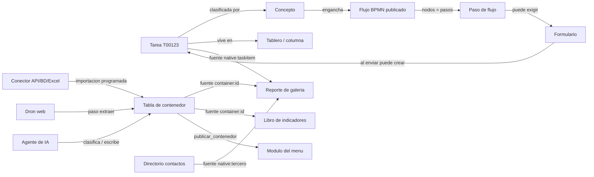

# Modelo mental del sistema ECOREX

Volver a [[00 - LEEME PRIMERO]]. Lo que necesitas saber del sistema ANTES de tocar herramientas.

## 1. Quien eres cuando usas el MCP

- ECOREX es **multi-empresa** (multi-tenant). Cada empresa (tenant) es un mundo aislado: nunca veras datos de otra.
- El token pertenece a **un usuario** de **una empresa**. Eres ese usuario: mismos permisos, misma visibilidad.
- Los permisos vienen de la matriz **Roles y permisos** por modulo (tareas, flujos, formularios, contenedor de
  datos, agentes...). Owner/Admin de la empresa tienen acceso total. Si una herramienta responde "sin permiso",
  es el permiso del usuario, no un error tuyo: diselo.
- Todo lo que escribes queda auditado y firmado "(via IA)".

## 2. Como se conectan las piezas

## 3. Glosario por area

### Trabajo diario (tareas)
- **Tablero:** Kanban con **columnas**. Algunas columnas son **de cierre** y el tablero puede exigir un
  **motivo de cierre** (concepto de cierre).
- **Tarea = actividad:** se identifica por su **numero** (`T00123`). Tiene titulo, descripcion, prioridad
  (baja/media/alta), vencimiento, **encargado**, solicitante, checklist, bitacora (comentarios) y horas.
- **Concepto:** el *tipo* de actividad (ej. "Cotizacion", "Soporte"). Si tiene un flujo enganchado, al crear una
  tarea con ese concepto **arranca el flujo**.
- **Tarea gobernada por flujo:** su columna la mueve el flujo. NO se mueve ni se termina a mano: se avanza el
  **paso** (`completar_paso`).

### Procesos (flujos BPMN)
- **Flujo / definicion:** grafo de **nodos** (`inicio`, `tarea` = paso humano, `compuerta` = decision, `fin`)
  unidos por **aristas** (con **condicion** en las salidas de compuertas).
- **Borrador vs publicado:** se edita el borrador; publicado = version activa. Para cambiar uno publicado:
  `nueva_version_flujo`.
- **Encargado del paso:** por **politica** (cargos/dependencias del organigrama), el que inicio el flujo, el que
  cerro el paso anterior, o un usuario elegido en un campo de formulario.
- **Paso:** la instancia de un nodo en una tarea concreta. Se **toma** (si esta sin asignar) y se **completa**
  (con una **opcion**/ruta si la tiene).

### Formularios
- **Formulario:** `code` unico + titulo; estados borrador / activo / inactivo / archivado. Se compone de
  **contenedores** (Section, Row, Col, Tabs, Segment, Table, Modal) y **preguntas/campos** (`field_code` unico,
  `control_type`: Text, Number, Select, Date, GridDetail, Signature, Photo...).
- **Registro / respuesta:** cada diligenciamiento. Un formulario **transaccional** numera sus registros.
- **Plantilla imprimible:** documento con marcadores (`{{campo.codigo}}`) para imprimir/PDF.
- **Enlace publico:** `/f/{token}` para que alguien externo lo llene.

### Directorio (terceros)
- **Contacto:** empresa o persona; estados activo / prospecto / inactivo; identificacion (NIT, cedula...);
  campos configurables por ficha; notas; personas vinculadas a empresas con su cargo.

### Datos (contenedores)
- **Contenedor de datos:** una mini base de datos. Tiene **tablas** (raiz o hijas), cada una con **columnas**
  tipadas (texto, numero, decimal, fecha, booleano, submodelo) y **relaciones** (n1 = muchos a uno, nn).
- **Conector:** fuente que llena una tabla (excel, api REST, bd, tabla). Los secretos (claves, contrasenas) se
  ponen SOLO en pantalla.
- **Programacion de importacion (proceso):** cuando y como importa (manual, intervalo, cron) y en que **modo**:
  `append` (agrega), `replace` (reemplaza todo), `upsert` (inserta o actualiza por **columna clave**).
- **Corrida:** cada ejecucion (resultado, insertadas/actualizadas/borradas, detalle).
- **Publicar:** una tabla raiz puede salir como **modulo del menu**, con permisos por rol.

### Extraccion web (drones)
- **Dron:** robot de navegador con **pasos** (navegar, esperar, clic, extraer, ia...), **variables** (pueden ser
  secretas) y **programaciones**. Corre en un **agente colmena** (un PC/servidor del cliente con navegador real),
  por eso puede pasar retos anti-bot que un servidor no pasa.

### Inteligencia artificial
- **Agente de IA:** proveedor (claude, gemini, chatgpt, deepseek) + modelo + **prompt de sistema** + prompts
  enrutados + recursos + **lector de medios** (como lee PDF/imagenes) + herramientas habilitadas. Nace apagado.
- **Cupo de IA:** el plan de la empresa limita el consumo; las operaciones de IA cortan al llegar al cupo.
- **Clasificacion con marca:** columna marca vacia = fila pendiente; la IA escribe columnas de salida y sella la
  marca. Incremental e idempotente.

### Analitica
- **Fuente de reporte:** nativa (`native:taskitem` actividades, `native:tercero` directorio, `native:worklog`
  horas...), **tabla de contenedor** (`container:{tabla_id}`) o externa.
- **Reporte de galeria:** panel guardado (tabla/barras/torta/linea) en una **categoria** (pestana).
- **Libro de indicadores:** dashboard con **hojas** y **widgets** (kpi, barras, dona, embudo, treemap, linea,
  area, tabla) en rejilla de 4 columnas.

### Maquetas y WhatsApp
- **Maqueta:** proyecto de pantallas HTML con **solicitudes** de ajuste (tarjetas `T000xx` con captura y selector
  CSS), **versiones** publicadas y un **cerebro digital** (notas enlazadas).
- **Linea de WhatsApp:** numero conectado por Evolution API; **SARA** es el agente que suele atender los chats.

## 4. Convenciones que aplican a TODAS las herramientas

- **Nombre o id:** casi todos los parametros de referencia (`tablero`, `contenedor`, `tabla`, `agente`, `flujo`,
  `dron`...) aceptan el **nombre** o el **id**. Las tareas se referencian por **numero** (`T00123`).
- **Editar = solo lo que envias:** las herramientas `editar_*` / `update_*` cambian unicamente los campos que
  mandas; lo demas se conserva.
- **Validan antes de guardar:** reportes, indicadores, formularios y flujos ejecutan o revisan antes de guardar;
  si algo no cuadra, NO guardan y te explican.
- **Fechas:** ISO 8601 (`2026-12-15`). Los **cron** son de 5 campos en **hora de la empresa** (ej. `0 7 * * *` =
  7:00 am hora local).
- **Respuestas:** JSON con `ok`, ids creados y avisos. Lee los avisos: suelen decir exactamente que falta.

Siguiente: [[03 - Reglas de oro]].
