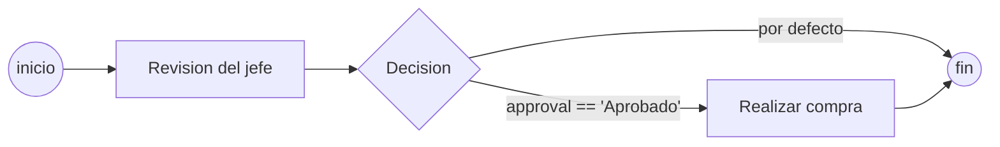

# R03 - Disenar y publicar un flujo (proceso BPMN)

Volver a [[00 - LEEME PRIMERO]]. Referencia: [[T03 - Flujos de proceso (BPMN)]].

Ejemplo: proceso de **aprobacion de compra**: Solicitud -> Revision del jefe -> (Aprobado: Compra / Rechazado: fin).



## Paso 0 - Descubrir

`listar_flujos` (que existe), `listar_conceptos` (a que tipo de actividad se va a enganchar). Si el flujo ya
existe publicado y hay que cambiarlo, salta a **"Modificar uno publicado"**.

## Paso 1 - Crear el borrador

```json
{"name":"crear_flujo","arguments":{"nombre":"Aprobacion de compra","categoria":"Compras"}}
```
Devuelve `definicion_id` y los nodos `inicio` y `fin` **ya conectados**. Anota sus ids.

## Paso 2 - Insertar pasos en cadena

Cada `agregar_nodo` con `desde_nodo_id` + `hasta_nodo_id` se INSERTA entre ellos (reemplaza la conexion directa):

```json
{"name":"agregar_nodo","arguments":{"flujo":"<definicion_id>","tipo":"tarea","nombre":"Revision del jefe",
  "desde_nodo_id":"<id_inicio>","hasta_nodo_id":"<id_fin>"}}
```
-> devuelve `nodo_id` (R). Ahora inserta la compuerta entre R y fin:
```json
{"name":"agregar_nodo","arguments":{"flujo":"<definicion_id>","tipo":"compuerta","nombre":"Decision",
  "desde_nodo_id":"<id_R>","hasta_nodo_id":"<id_fin>"}}
```
-> (G). Y la tarea "Realizar compra" entre G y fin:
```json
{"name":"agregar_nodo","arguments":{"flujo":"<definicion_id>","tipo":"tarea","nombre":"Realizar compra",
  "desde_nodo_id":"<id_G>","hasta_nodo_id":"<id_fin>"}}
```
Falta la ruta de rechazo G -> fin (directa):
```json
{"name":"conectar_nodos","arguments":{"desde_nodo_id":"<id_G>","hasta_nodo_id":"<id_fin>"}}
```

## Paso 3 - Condiciones de la compuerta

`ver_flujo` -> identifica las aristas que salen de G. A la que va a "Realizar compra":
```json
{"name":"condicion_ruta","arguments":{"arista_id":"<arista_G_a_Compra>","condicion":"approval == 'Aprobado'"}}
```
La arista G -> fin queda sin condicion = **ruta por defecto**. (Formato del motor: `approval == 'Valor'`.)

> Regla de oro: una **tarea** que tenga dos salidas las sigue AMBAS en paralelo. Las decisiones van SIEMPRE en una
> compuerta.

## Paso 4 - Quien atiende cada paso

```json
{"name":"asignar_encargado_nodo","arguments":{"nodo_id":"<id_R>","origen":"politica"}}
{"name":"asignar_cargo_nodo","arguments":{"nodo_id":"<id_R>","cargo":"Jefe de area"}}
{"name":"asignar_encargado_nodo","arguments":{"nodo_id":"<id_Compra>","origen":"hereda_inicio"}}
```
Origenes: `politica` (cargos/dependencias del organigrama; si el cargo no existe la respuesta lista los validos),
`hereda_inicio` (quien arranco el flujo), `hereda_anterior` (quien cerro el paso previo), `campo_formulario`
(usuario elegido en un campo; indica `campo` con su codigo).

## Paso 5 - Formularios en los pasos (opcional)

El formulario debe estar **activo** (ver [[R04 - Crear un formulario completo]]):
```json
{"name":"poner_formulario_a_nodo","arguments":{"nodo_id":"<id_R>","formulario":"SOL-COMPRA","obligatorio":true}}
```
`obligatorio:true` = el paso no se cierra hasta enviar el formulario.

## Paso 6 - Revisar, publicar y enganchar

```json
{"name":"ver_flujo","arguments":{"flujo":"Aprobacion de compra"}}
```
Si trae **avisos** (ramas paralelas involuntarias, nodos sin entrada/salida, pasos sin quien los atienda),
corrigelos o muestraselos al usuario.
```json
{"name":"publicar_flujo","arguments":{"flujo":"<definicion_id>"}}
{"name":"enganchar_flujo_a_concepto","arguments":{"concepto":"Solicitud de compra","flujo":"Aprobacion de compra"}}
```
`forzar:true` en `publicar_flujo` SOLO con visto bueno del usuario. Desde ahora, toda tarea nueva con ese concepto
arranca el flujo: pruebalo con `crear_tarea` (concepto) + `ver_tarea`.

## Modificar uno publicado

```json
{"name":"nueva_version_flujo","arguments":{"flujo":"Aprobacion de compra"}}
```
Devuelve un borrador con **ids NUEVOS** de nodos y aristas: vuelve a `ver_flujo` antes de editar. Edita
(`renombrar_nodo`, `agregar_nodo`, `eliminar_conexion`, `eliminar_nodo` -con confirmacion-) y publica: los
conceptos enganchados pasan solos a la version nueva.

## Importar un BPMN

Si el usuario tiene un `.bpmn` (bpmn.io u otro modelador): `importar_bpmn` con `bpmn_xml` crea el borrador;
luego pasos 3 a 6.
