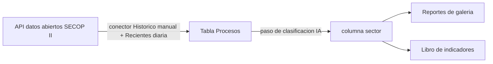

# R11 - Caso completo de punta a punta: oportunidades de contratacion publica

Volver a [[00 - LEEME PRIMERO]]. Este caso se construyo de verdad, completo, solo por MCP. Usalo como modelo
para cualquier "traer datos -> enriquecer con IA -> reportar".

**Objetivo del usuario:** "Quiero ver todas las licitaciones publicas de Colombia, saber de que sector es cada
una y tener un tablero con montos por sector, solo de las que siguen abiertas".



## Fase 1 - Investigar la fuente (no configures nada aun)

- El portal web de SECOP tiene **reCAPTCHA** -> un dron no sirve. Pero existe el dataset abierto
  **"SECOP II - Procesos de Contratacion"** en datos.gov.co (plataforma Socrata), sin autenticacion:
  `https://www.datos.gov.co/resource/p6dx-8zbt.json` (~9 millones de filas).
- Socrata se consulta con `$where`, `$order`, `$limit` (tope 50.000), `$offset`, `$select`.
- Conteo de una ventana (para validar despues):
  `...p6dx-8zbt.json?$select=count(1)&$where=fecha_de_publicacion_del between '2026-11-19T00:00:00' and '2026-11-19T23:59:59'`
- Campos relevantes: `id_del_proceso` (clave), `entidad`, `nombre_del_procedimiento`,
  `descripci_n_del_procedimiento`, `modalidad_de_contratacion`, `tipo_de_contrato`,
  `codigo_principal_de_categoria` (UNSPSC, ~70% viene sin especificar), `precio_base`, `estado_del_procedimiento`,
  `fecha_de_publicacion_del`, `urlproceso` (objeto: la URL esta en `urlproceso.url`).
- Medido: `$order=fecha_de_publicacion_del DESC&$limit=5000` responde en ~2 s; un `$where` sobre fecha tarda ~20 s
  (recorre todo); paginas de 50.000 filas tardan ~30 s cada una.

## Fase 2 - Contenedor y tabla

```json
{"name":"crear_contenedor_datos","arguments":{"nombre":"SECOP II - Procesos","descripcion":"Procesos de contratacion publica (datos.gov.co)"}}
{"name":"agregar_tabla","arguments":{"contenedor":"SECOP II - Procesos","nombre":"Procesos","columnas":[
  {"nombre":"id_proceso","tipo":"texto","requerido":true},{"nombre":"entidad","tipo":"texto"},
  {"nombre":"nombre_proceso","tipo":"texto"},{"nombre":"descripcion","tipo":"texto"},
  {"nombre":"modalidad","tipo":"texto"},{"nombre":"tipo_contrato","tipo":"texto"},
  {"nombre":"categoria_unspsc","tipo":"texto"},{"nombre":"precio_base","tipo":"decimal"},
  {"nombre":"estado","tipo":"texto"},{"nombre":"fecha_publicacion","tipo":"texto"},
  {"nombre":"url_proceso","tipo":"texto"},{"nombre":"sector","tipo":"texto"},{"nombre":"clasificado_en","tipo":"texto"}]}}
```
Leccion: `precio_base` como **decimal** desde el inicio (para sumar montos); `sector` + `clasificado_en` (marca)
preparadas para la IA.

## Fase 3 - Dos conectores sobre la misma tabla

Mapeo comun de campos (`fields`):
```
id_proceso<-id_del_proceso, entidad<-entidad, nombre_proceso<-nombre_del_procedimiento,
descripcion<-descripci_n_del_procedimiento, modalidad<-modalidad_de_contratacion, tipo_contrato<-tipo_de_contrato,
categoria_unspsc<-codigo_principal_de_categoria, precio_base<-precio_base, estado<-estado_del_procedimiento,
fecha_publicacion<-fecha_de_publicacion_del, url_proceso<-urlproceso.url
```

**Historico** (carga grande, a mano, por ventana de fechas; paginado):
```json
{"name":"guardar_conector","arguments":{"contenedor":"SECOP II - Procesos","nombre":"SECOP - Historico","tipo":"api",
  "destino":"Procesos","metodo":"GET","auth":"ninguna",
  "endpoint":"https://www.datos.gov.co/resource/p6dx-8zbt.json?$where=fecha_de_publicacion_del between '2026-08-01T00:00:00' and '2026-11-21T23:59:59'&$order=:id",
  "mapeo_json":"{\"paging\":{\"mode\":\"Offset\",\"offsetParam\":\"$offset\",\"limitParam\":\"$limit\",\"pageSize\":50000,\"maxPages\":1},\"fields\":[{\"column\":\"id_proceso\",\"path\":\"id_del_proceso\"},{\"column\":\"entidad\",\"path\":\"entidad\"},{\"column\":\"nombre_proceso\",\"path\":\"nombre_del_procedimiento\"},{\"column\":\"descripcion\",\"path\":\"descripci_n_del_procedimiento\"},{\"column\":\"modalidad\",\"path\":\"modalidad_de_contratacion\"},{\"column\":\"tipo_contrato\",\"path\":\"tipo_de_contrato\"},{\"column\":\"categoria_unspsc\",\"path\":\"codigo_principal_de_categoria\"},{\"column\":\"precio_base\",\"path\":\"precio_base\"},{\"column\":\"estado\",\"path\":\"estado_del_procedimiento\"},{\"column\":\"fecha_publicacion\",\"path\":\"fecha_de_publicacion_del\"},{\"column\":\"url_proceso\",\"path\":\"urlproceso.url\"}]}"}}
```
(`$order=:id` da paginacion estable. Una corrida trae max 50.000 filas: para mas, corre por ventanas.)

**Recientes** (diaria: las 10.000 con publicacion mas reciente, sin `$where`, una sola llamada):
```json
{"name":"guardar_conector","arguments":{"contenedor":"SECOP II - Procesos","nombre":"SECOP - Recientes","tipo":"api",
  "destino":"Procesos","metodo":"GET","auth":"ninguna",
  "endpoint":"https://www.datos.gov.co/resource/p6dx-8zbt.json?$order=fecha_de_ultima_publicaci DESC&$limit=10000",
  "mapeo_json":"{\"paging\":{\"mode\":\"None\"},\"fields\":[ ...los mismos 11 campos... ]}"}}
```
Leccion aprendida: la primera version de "Recientes" usaba un `$where` con una fecha FIJA (no rueda: la ventana
crecia cada dia) + paginas de 50.000, y la corrida diaria murio con **"Tiempo de espera agotado al llamar al
API"** (y sin importacion no corre la clasificacion). Se diagnostico con `ver_conector` y se corrigio con un
`guardar_conector` parcial (solo `endpoint` + `mapeo_json`). La configuracion de arriba es la recomendada:
ordenar por `fecha_de_ultima_publicaci` tambien trae los procesos que CAMBIARON (estado, fase), responde en
~20 s, cubre varios dias de margen (unos 2.000 procesos por dia) y el upsert no duplica. Con `mode: None` manda
el `$limit` del endpoint (con `Offset` el motor lo reescribe con `pageSize`).

## Fase 4 - Programaciones (ambas upsert por id_proceso)

```json
{"name":"guardar_programacion_importacion","arguments":{"contenedor":"SECOP II - Procesos","nombre":"Historico manual",
  "tipo":"manual","modo":"upsert","columna_clave":"id_proceso","conector":"SECOP - Historico","activa":true}}
{"name":"guardar_programacion_importacion","arguments":{"contenedor":"SECOP II - Procesos","nombre":"Recientes diaria",
  "tipo":"cron","cron":"0 5 * * *","modo":"upsert","columna_clave":"id_proceso","conector":"SECOP - Recientes","activa":true}}
```

## Fase 5 - Validar con poco, luego crecer

1. Pon el Historico en una ventana de **1 dia**; el usuario pulsa **Importar** en la pantalla del contenedor.
2. `listar_corridas_importacion` (`proceso:"Historico manual"`): en el caso real, `insertadas = 49` = conteo de
   Socrata (49) -> mapeo, paginacion y ventana correctos.
3. Ensancha la ventana (90 dias) y vuelve a importar. Revisa el detalle: si dice "Se alcanzo el limite de 50000
   filas por corrida", parte en varias ventanas.
4. Mira datos con un reporte en modo tabla.

## Fase 6 - Clasificar por sector con IA

Agente (DeepSeek, economico para volumen):
```json
{"name":"crear_agente","arguments":{"nombre":"Clasificador de procesos","rol":"Clasificador","proveedor":"deepseek",
  "prompt":"Clasificas procesos de contratacion publica por SECTOR segun el OBJETO del contrato (nombre + descripcion), NO segun la entidad que contrata.\nSectores permitidos (usa exactamente uno): tecnologia, infraestructura_obra, salud, educacion, transporte_movilidad, suministros_bienes, servicios_profesionales, servicios_generales, alimentos, seguridad_defensa, ambiente_serv_publicos, otros.\nRecibes un arreglo JSON de filas. Responde SOLO un arreglo JSON: [{\"id_proceso\":\"...\",\"sector\":\"...\"}]. Sin texto adicional. Si no hay senal suficiente usa 'otros'."}}
{"name":"encender_agente","arguments":{"agente":"Clasificador de procesos"}}
```
Prueba (5 filas) y revisa:
```json
{"name":"clasificar_lote","arguments":{"contenedor":"SECOP II - Procesos","tabla":"Procesos","agente":"Clasificador de procesos",
  "columna_clave":"id_proceso","columna_marca":"clasificado_en","columnas_salida":["sector"],
  "columnas_entrada":["nombre_proceso","descripcion","modalidad","tipo_contrato","categoria_unspsc"],"limite":5}}
```
Automatico para todo lo que llegue (y para drenar el backlog en el servidor):
```json
{"name":"configurar_paso_clasificacion","arguments":{"contenedor":"SECOP II - Procesos","programacion":"Recientes diaria",
  "agente":"Clasificador de procesos","columna_clave":"id_proceso","columna_marca":"clasificado_en","columnas_salida":["sector"],
  "columnas_entrada":["nombre_proceso","descripcion","modalidad","tipo_contrato","categoria_unspsc"],"limite":50,"max_lotes":20}}
```
Backlog de ~50.000 (con OK del usuario por los tokens): subir `max_lotes` a 200, `ejecutar_clasificacion_ahora`,
monitorear, y bajar a 20 al terminar. Ritmo observado: ~50-60 filas/min.

## Fase 7 - Reportes e indicadores

```json
{"name":"crear_libro_indicadores","arguments":{"nombre":"SECOP - Oportunidades","descripcion":"Procesos por sector y monto"}}
{"name":"agregar_indicador","arguments":{"libro":"<libro_id>","titulo":"Procesos","tipo":"kpi","ancho":1,
  "contenedor":"SECOP II - Procesos","tabla":"Procesos","consulta":{"agregaciones":[{"funcion":"contar"}]}}}
{"name":"agregar_indicador","arguments":{"libro":"<libro_id>","titulo":"Monto total (COP)","tipo":"kpi","ancho":1,
  "contenedor":"SECOP II - Procesos","tabla":"Procesos","consulta":{"agregaciones":[{"funcion":"sumar","campo":"precio_base"}]}}}
{"name":"agregar_indicador","arguments":{"libro":"<libro_id>","titulo":"Monto por sector","tipo":"barras","ancho":2,
  "contenedor":"SECOP II - Procesos","tabla":"Procesos",
  "consulta":{"agrupar_por":"sector","agregaciones":[{"funcion":"sumar","campo":"precio_base"}],"orden":[{"campo":"suma","desc":true}]}}}
{"name":"agregar_indicador","arguments":{"libro":"<libro_id>","titulo":"Top entidades por monto","tipo":"tabla","ancho":4,
  "contenedor":"SECOP II - Procesos","tabla":"Procesos",
  "consulta":{"agrupar_por":"entidad","agregaciones":[{"funcion":"contar"},{"funcion":"sumar","campo":"precio_base"}],
              "orden":[{"campo":"suma","desc":true}],"limite":20}}}
```
**Solo ofertas abiertas** ("activas" = estado `Publicado` o `Abierto`): misma consulta + filtro, como widgets o
reportes aparte (los filtros son fijos):
```json
{"name":"crear_reporte","arguments":{"nombre":"SECOP ACTIVAS - Resumen por sector","categoria":"SECOP","grafico":"tabla",
  "contenedor":"SECOP II - Procesos","tabla":"Procesos",
  "consulta":{"filtros":[{"campo":"estado","operador":"en","valores":["Publicado","Abierto"]}],"agrupar_por":"sector",
              "agregaciones":[{"funcion":"contar"},{"funcion":"sumar","campo":"precio_base"},{"funcion":"promedio","campo":"precio_base"}],
              "orden":[{"campo":"suma","desc":true}]}}}
```
Leccion: el proceso de mayor monto del total ya estaba "Seleccionado" y **no** aparece en activas: valida el filtro.

## Fase 8 - Operacion diaria y monitoreo

- Cada dia 5:00 am: importa lo reciente (upsert) -> clasifica lo nuevo -> los reportes muestran datos frescos.
- Revisa `listar_corridas_importacion` de "Recientes diaria": si dice `error`, la clasificacion no corrio (ver
  Fase 3, leccion del timeout).
- Avance de la IA: reporte agrupado por `sector` (grupo `null` = pendientes), con `ver_reporte`.

## Variante B - Portal web sin API (dron)

Mismo patron cambiando la Fase 3 por un **dron** ([[R08 - Crear un dron de extraccion]]): navegar -> esperar
(`espera_ms`) -> extraer (JS que devuelve filas con `url` del documento). Si un mismo documento aparece bajo varios
procesos, la llave de ingesta es compuesta (`numero_proceso|url`): crear columna `clave_ingesta`, rellenarla en las
filas existentes con `rellenar_columna` (`{numero_proceso}|{url}`) y solo entonces poner `ingesta_llave`. Programar
con `guardar_programacion` (cron diario). Verificado: tras activar la llave, la corrida diaria mantuvo el conteo
igual (cero duplicados).
