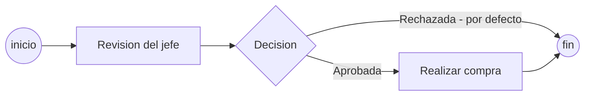

# F03 - Receta aprobacion de un nivel

Volver a [[00 - LEEME PRIMERO]]. Antes: [[F02 - Las dos formas de decidir]].

Proceso: el solicitante crea la tarea -> el **jefe revisa** y elige Aprobada o Rechazada -> si se aprueba, **compras
realiza la compra**; si se rechaza, termina.



Usa la compuerta AUTOMATICA: decide quien cierra "Revision del jefe".

## 1. Borrador

```json
{"name":"crear_flujo","arguments":{"nombre":"Aprobacion de compra","categoria":"Compras"}}
```
Anota `definicion_id`, el id de `inicio` y el de `fin` (ya vienen conectados).

## 2. Pasos en cadena (insertar entre dos nodos reemplaza la conexion directa)

```json
{"name":"agregar_nodo","arguments":{"flujo":"<definicion_id>","tipo":"tarea","nombre":"Revision del jefe","desde_nodo_id":"<id_inicio>","hasta_nodo_id":"<id_fin>"}}
{"name":"agregar_nodo","arguments":{"flujo":"<definicion_id>","tipo":"compuerta","nombre":"Decision","desde_nodo_id":"<id_revision>","hasta_nodo_id":"<id_fin>"}}
{"name":"agregar_nodo","arguments":{"flujo":"<definicion_id>","tipo":"tarea","nombre":"Realizar compra","desde_nodo_id":"<id_decision>","hasta_nodo_id":"<id_fin>"}}
```

## 3. Salidas de la compuerta: NOMBRE + condicion

Tras el paso 2 la compuerta tiene UNA salida (hacia "Realizar compra"). `ver_flujo` -> su `arista_id`:

```json
{"name":"nombre_salida","arguments":{"arista_id":"<arista_decision_a_compra>","nombre":"Aprobada"}}
{"name":"condicion_ruta","arguments":{"arista_id":"<arista_decision_a_compra>","condicion":"approval == 'Aprobada'"}}
{"name":"conectar_nodos","arguments":{"desde_nodo_id":"<id_decision>","hasta_nodo_id":"<id_fin>","nombre":"Rechazada"}}
```

"Rechazada" queda sin condicion = ruta por defecto. "Revision del jefe" ofrecera **Aprobada | Rechazada**.

## 4. Quien atiende

```json
{"name":"asignar_encargado_nodo","arguments":{"nodo_id":"<id_revision>","origen":"politica"}}
{"name":"asignar_cargo_nodo","arguments":{"nodo_id":"<id_revision>","cargo":"Jefe de area"}}
{"name":"asignar_encargado_nodo","arguments":{"nodo_id":"<id_compra>","origen":"politica"}}
{"name":"asignar_cargo_nodo","arguments":{"nodo_id":"<id_compra>","cargo":"Compras"}}
```
Si el cargo no existe, la respuesta lista los validos: no lo inventes, pregunta al usuario.

## 5. Formularios, tiempos y avisos (opcional, recomendado)

```json
{"name":"poner_formulario_a_nodo","arguments":{"nodo_id":"<id_revision>","formulario":"Solicitud de compra","obligatorio":true}}
{"name":"plazo_nodo","arguments":{"nodo_id":"<id_revision>","dias":2,"dias_habiles":true}}
{"name":"agregar_notificacion_nodo","arguments":{"nodo_id":"<id_compra>","canal":"correo","destino":"encargado_paso","asunto":"Compra aprobada {tarea.numero}","mensaje":"Se aprobo la compra {tarea.titulo}. Realizala.","incluir_enlace":true}}
```

## 6. Revisar, publicar, enganchar

```json
{"name":"ver_flujo","arguments":{"flujo":"<definicion_id>"}}
{"name":"publicar_flujo","arguments":{"flujo":"<definicion_id>"}}
{"name":"enganchar_flujo_a_concepto","arguments":{"concepto":"Solicitud de compra","flujo":"<definicion_id>"}}
```
`ver_flujo` sin `avisos` antes de publicar. Si `publicar_flujo` devuelve avisos, NO uses `forzar` sin mostrarselos al
usuario. Ver [[F10 - Checklist antes de publicar]].
