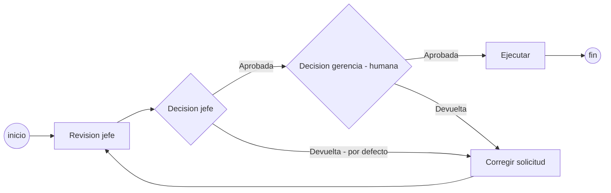

# F04 - Receta aprobacion en dos niveles con devolucion

Volver a [[00 - LEEME PRIMERO]]. Base: [[F03 - Receta aprobacion de un nivel]].

Proceso: Jefe revisa -> (Aprobada) Gerencia decide -> (Aprobada) Ejecutar; cualquiera de los dos puede **Devolver**
para que el solicitante corrija, y la correccion vuelve a la revision del jefe.



## Claves de diseno

- **Decision jefe** = compuerta AUTOMATICA (decide quien cierra "Revision jefe"): salidas con nombre + condicion.
- **Decision gerencia** = compuerta con DECISION HUMANA: aparece en la bandeja de Gerencia como paso propio
  (`decision_humana_nodo` + encargado por cargo). Elige por destino.
- **Corregir solicitud** la hace quien creo la tarea: `origen` = `hereda_inicio`.
- El ciclo Corregir -> Revision jefe es una salida normal (`conectar_nodos`): el motor admite volver atras.

## Pasos

1. `crear_flujo`; inserta en cadena: Revision jefe, Decision jefe (compuerta), Decision gerencia (compuerta),
   Ejecutar (todas con `agregar_nodo` + `desde_nodo_id`/`hasta_nodo_id`).
2. Agrega "Corregir solicitud" suelto y conectalo:

```json
{"name":"agregar_nodo","arguments":{"flujo":"<definicion_id>","tipo":"tarea","nombre":"Corregir solicitud"}}
{"name":"conectar_nodos","arguments":{"desde_nodo_id":"<id_decision_jefe>","hasta_nodo_id":"<id_corregir>","nombre":"Devuelta"}}
{"name":"conectar_nodos","arguments":{"desde_nodo_id":"<id_decision_gerencia>","hasta_nodo_id":"<id_corregir>","nombre":"Devuelta"}}
{"name":"conectar_nodos","arguments":{"desde_nodo_id":"<id_corregir>","hasta_nodo_id":"<id_revision_jefe>"}}
```

3. Decision jefe (automatica): la salida hacia Decision gerencia se llama "Aprobada" con condicion; "Devuelta" sin
   condicion (por defecto).

```json
{"name":"nombre_salida","arguments":{"arista_id":"<arista_jefe_a_gerencia>","nombre":"Aprobada"}}
{"name":"condicion_ruta","arguments":{"arista_id":"<arista_jefe_a_gerencia>","condicion":"approval == 'Aprobada'"}}
```

4. Decision gerencia (humana):

```json
{"name":"decision_humana_nodo","arguments":{"nodo_id":"<id_decision_gerencia>","activo":true}}
{"name":"asignar_encargado_nodo","arguments":{"nodo_id":"<id_decision_gerencia>","origen":"politica"}}
{"name":"asignar_cargo_nodo","arguments":{"nodo_id":"<id_decision_gerencia>","cargo":"Gerente"}}
{"name":"nombre_salida","arguments":{"arista_id":"<arista_gerencia_a_ejecutar>","nombre":"Aprobada"}}
```

5. Encargados: Revision jefe por cargo, Corregir `hereda_inicio`, Ejecutar por cargo o `hereda_anterior`.

6. (Opcional) Exigir el motivo SOLO cuando Gerencia devuelve: formulario en la compuerta de gerencia, obligatorio
   en la salida "Devuelta" ([[F05 - Receta decision del cliente por enlace]] muestra la misma tecnica).

```json
{"name":"poner_formulario_a_nodo","arguments":{"nodo_id":"<id_decision_gerencia>","formulario":"Motivo de devolucion"}}
{"name":"formulario_obligatorio_por_salida","arguments":{"nodo_id":"<id_decision_gerencia>","formulario":"Motivo de devolucion","salidas":["<id_corregir>"]}}
```

7. `ver_flujo` sin avisos -> `publicar_flujo` -> `enganchar_flujo_a_concepto`.

## Variante: "abrir un ciclo nuevo"

Si en vez de volver a un paso quieres que el flujo **reinicie** (cuenta un ciclo nuevo y vuelve a pasar por los
pasos), usa `reinicio_nodo` en el nodo donde termina la vuelta:

```json
{"name":"reinicio_nodo","arguments":{"nodo_id":"<id_fin_rechazo>","reiniciar_en_nodo_id":"<id_revision_jefe>"}}
```
Solo en borrador.
