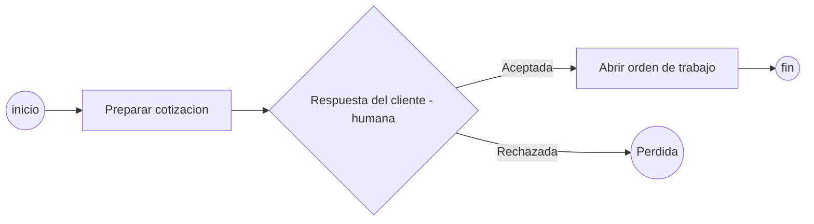

# F05 - Receta decision del cliente por enlace

Volver a [[00 - LEEME PRIMERO]]. Antes: [[F02 - Las dos formas de decidir]].

Proceso: se envia una cotizacion -> el **cliente** recibe un correo (o WhatsApp) con dos enlaces: **Aceptar** (firma)
y **Rechazar** (observacion obligatoria). Al abrir uno, el flujo toma esa salida solo.



## 1. Grafo

Compuerta "Respuesta del cliente" con dos salidas con nombre (Aceptada -> Abrir orden; Rechazada -> fin "Perdida").

## 2. La compuerta es de DECISION HUMANA

Los enlaces eligen la salida por su destino, igual que una persona. Ademas pon un encargado interno: si el cliente
no responde, esa persona puede decidir a mano desde su bandeja.

```json
{"name":"decision_humana_nodo","arguments":{"nodo_id":"<id_respuesta>","activo":true}}
{"name":"asignar_encargado_nodo","arguments":{"nodo_id":"<id_respuesta>","origen":"hereda_anterior"}}
```

## 3. El aviso con los enlaces (en la compuerta: se envia al LLEGAR a ella)

```json
{"name":"agregar_notificacion_nodo","arguments":{"nodo_id":"<id_respuesta>","canal":"correo","destino":"contacto_tarea","asunto":"Tu cotizacion {tarea.numero}","mensaje":"Hola {tarea.cliente}. Para aceptar la cotizacion entra a {aceptar}. Si no te interesa, cuentanos por que en {rechazar}.","enlaces_decision":[{"variable":"aceptar","salida_nodo_id":"<id_abrir_orden>","captura":"firma","boton":"Acepto la cotizacion","vence_horas":168},{"variable":"rechazar","salida_nodo_id":"<id_perdida>","captura":"observacion","observacion_obligatoria":true,"boton":"Rechazar"}]}}
```

- `destino: contacto_tarea` = el correo/telefono del solicitante de la tarea (el cliente).
- Cada enlace llena la **variable** del mensaje (`{aceptar}`, `{rechazar}`) con su URL publica.
- `captura`: `ninguna` (solo confirma), `firma` (dibuja su firma; queda como evidencia), `observacion` (texto).
- `etiqueta` (opcional) agrega una etiqueta a la tarea segun la salida elegida (ej. "Perdida por precio").
- Por **WhatsApp**: `canal: whatsapp` + `linea_id` + `plantilla` (HSM aprobada) y la `variable` de cada enlace debe
  existir en la plantilla. `variables` mapea las demas variables de la plantilla a tokens.

Tokens utiles: `{tarea.numero}`, `{tarea.titulo}`, `{tarea.cliente}`, `{tarea.telefono}`, `{tarea.correo}`,
`{usuario.nombre}` (encargado del paso), `{empresa.nombre}`, `{sistema.fecha}`, `{sistema.fechalarga}`, y
`{form.<codigo_de_campo>}` de los formularios de la tarea.

## 4. (Opcional) Formulario obligatorio solo al rechazar

```json
{"name":"poner_formulario_a_nodo","arguments":{"nodo_id":"<id_respuesta>","formulario":"Motivo de perdida"}}
{"name":"formulario_obligatorio_por_salida","arguments":{"nodo_id":"<id_respuesta>","formulario":"Motivo de perdida","salidas":["<id_perdida>"]}}
{"name":"formulario_crear_al_llegar","arguments":{"nodo_id":"<id_respuesta>","formulario":"Motivo de perdida","activo":false}}
```

## 5. Verificar

`ver_flujo` -> en la compuerta: `decision_humana: true`, `avisos_al_llegar[0].detalle.enlaces_decision` con 2
salidas. Para probar de punta a punta usa una tarea de prueba cuyo contacto sea un correo del USUARIO (nunca un
cliente real) y avisale que se enviara un correo.

Quitar un aviso: `quitar_notificacion_nodo` con su `numero` (el que muestra `ver_flujo`).
